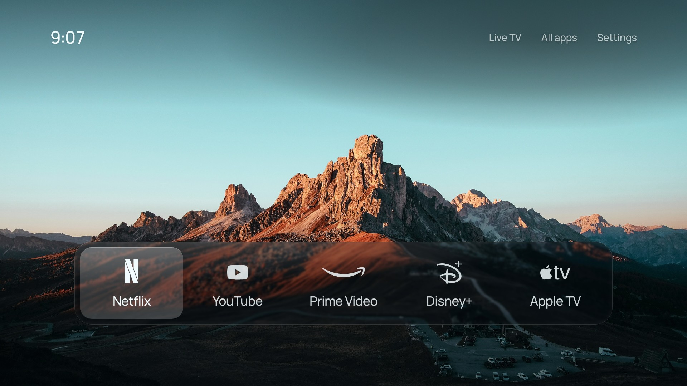

# CleanFrame per TV LG

Una schermata iniziale più tranquilla per la tua TV LG: le tue app, una fotografia e l'ora, da usare con il telecomando.



Questa è una versione di [CleanFrame](https://github.com/nthnclrk/CleanFrame) di Nathan Clark, nata per le Samsung The Frame (sistema Tizen) e qui adattata alle TV LG con **webOS**. È preparata per la **LG 50UQ75006LF** (modello 2022, webOS 22), ma dovrebbe funzionare anche su altre LG con webOS 6 o successivo.

> **Stato:** l'app è stata provata nel browser con una TV LG simulata (centinaia di controlli automatici), ma non ancora su una TV vera. Se qualcosa non va, annota cosa vedi sullo schermo e la versione software della TV (Impostazioni → Generali → Informazioni sulla TV).

L'interfaccia dell'app è in inglese, come l'originale.

## Cosa fa e cosa no

**Fa:**

- mostra fino a 9 app preferite su una foto, con l'ora (formato 24 ore);
- apre le app con OK. All'inizio ci sono Netflix, YouTube, Prime Video, Disney+ e Apple TV; da **All apps** o **Settings → Apps on Home** puoi aggiungere, togliere e riordinare le app installate (per esempio RaiPlay o DAZN);
- **Live TV** apre i canali TV; **Settings → LG** apre la Home LG e le impostazioni della TV;
- offre 15 sfondi, layout a lista o a dock, vari caratteri e stili, e ricorda le tue scelte;
- finché CleanFrame è in primo piano, il salvaschermo LG non copre la foto.

**Non fa** (sono limiti di webOS per le app installate così):

- non sostituisce il tasto **Home** del telecomando, che apre sempre la Home LG;
- non si apre da sola quando accendi la TV;
- per aprirla al volo usi un tasto numerico del telecomando (accesso rapido, passo 5).

L'installazione usa la **Modalità sviluppatore** ufficiale di LG: non modifica il sistema della TV e l'app si può togliere quando vuoi. Come l'originale, la usi a tuo rischio.

## Cosa ti serve

- La TV e un computer (Windows, Mac o Linux) **oppure un telefono Android**, collegati **alla stessa rete** (lo stesso Wi-Fi o router). Servono solo per installare l'app: dopo, CleanFrame funziona da sola sulla TV.
- Un **account sviluppatore LG**, gratuito.
- Il pacchetto dell'app, il file **`io.cleanframe.lg_0.6.1_all.ipk`** (passo 3).

## Passo 1 — Crea l'account sviluppatore LG

1. Sul computer apri [webostv.developer.lge.com](https://webostv.developer.lge.com), scegli **Sign In** e crea un account con la tua email.
2. Conferma l'indirizzo email dal messaggio che ricevi.

## Passo 2 — Attiva la Modalità sviluppatore sulla TV

1. Sulla TV apri **LG Content Store** (lo store delle app), cerca **Developer Mode** e installala.
2. Apri **Developer Mode** e accedi con l'account del passo 1.
3. Attiva **Dev Mode Status**. La TV chiede di riavviarsi: conferma.
4. Riapri **Developer Mode** e attiva **Key Server**.
5. Lascia aperta questa schermata: ti servono l'**IP** della TV e la **Passphrase** (6 caratteri; maiuscole e minuscole contano).

## Passo 3 — Scarica il pacchetto

Il pacchetto viene creato automaticamente su GitHub a ogni modifica:

1. In questo repository apri la scheda **Actions**.
2. Apri l'ultima esecuzione riuscita (spunta verde) di **Check and build**.
3. In fondo alla pagina, sotto **Artifacts**, scarica **CleanFrame-LG-webOS**.
4. Estrai lo `.zip`: dentro c'è il file `.ipk`.

Se preferisci, puoi crearlo tu sul computer (vedi [Per sviluppatori](#per-sviluppatori)).

## Passo 4 — Installa l'app sulla TV

### Metodo semplice: webOS Dev Manager (senza comandi)

1. Scarica **webOS Dev Manager** dalla [pagina delle versioni](https://github.com/webosbrew/dev-manager-desktop/releases/latest): il file `.msi` per Windows, `.dmg` per Mac, `.deb` o `.AppImage` per Linux. Installalo e aprilo.
2. Aggiungi la TV (**Add device**) inserendo l'IP e la Passphrase che vedi in Developer Mode. Lascia il resto com'è.
3. Nella sezione delle app premi **Install** e scegli il file `.ipk`.
4. Al termine, CleanFrame compare tra le app della TV.

### In alternativa: dalla riga di comando

Serve [Node.js](https://nodejs.org). Installa gli strumenti ufficiali LG:

```bash
npm install -g @webos-tools/cli
```

Registra la TV (metti il suo IP al posto di `192.168.1.50`):

```bash
ares-setup-device -a tv -i "host=192.168.1.50" -i "port=9922" -i "username=prisoner"
```

Scarica la chiave della TV (ti chiede la Passphrase):

```bash
ares-novacom --getkey -d tv
```

Dalla cartella in cui si trova il file `.ipk`, installa e apri l'app:

```bash
ares-install -d tv io.cleanframe.lg_0.6.1_all.ipk
```

```bash
ares-launch -d tv io.cleanframe.lg
```

### Senza computer: da un telefono Android

Con l'app gratuita **Termux** (un terminale per Android) puoi usare dal telefono gli stessi strumenti ufficiali LG. Il telefono deve essere sullo stesso Wi-Fi della TV. Questo metodo non è ancora stato provato su un telefono vero; su iPhone non c'è un modo comodo.

1. Installa **Termux** da [F-Droid](https://f-droid.org/packages/com.termux/) o dal Play Store.
2. Scarica sul telefono il file `.ipk` (passo 3; se scarichi lo `.zip` da GitHub, estrailo). Di solito finisce nella cartella **Download**.
3. Apri Termux e scrivi questi comandi, uno alla volta. Gli avvisi durante l'installazione (*warning*) si possono ignorare.

```bash
pkg install -y nodejs
```

```bash
npm install -g @webos-tools/cli
```

Questo chiede il permesso di vedere i file del telefono: rispondi **Consenti**.

```bash
termux-setup-storage
```

```bash
cd ~/storage/downloads
```

4. Continua con i comandi del metodo precedente, da `ares-setup-device` in poi.

## Passo 5 — Primo avvio

1. Premi **Home** sul telecomando e apri **CleanFrame** dall'elenco delle app.
2. **Accesso rapido:** con CleanFrame aperta, **tieni premuto un tasto numerico** da 1 a 8 (per esempio **1**) e conferma. Da quel momento, tenendo premuto quel numero da qualsiasi schermata, si apre CleanFrame. Tenendo premuto **0** puoi modificare gli accessi rapidi.
3. La prima volta che apri **All apps** (in alto a destra), la TV chiede il permesso di far vedere a CleanFrame l'elenco delle app installate: **accetta**. Così puoi aggiungere qualsiasi app. Se rifiuti, CleanFrame mostra solo le app più comuni che riconosce; per ricevere di nuovo la richiesta usa **Settings → LG → Installed apps**.

## Come si usa

| Tasto | Cosa fa |
| --- | --- |
| Frecce | Spostano la selezione |
| OK | Apre l'app o la voce selezionata |
| Indietro | Chiude un pannello; dalla schermata principale chiede se andare alla Home LG |
| Home | Apre la Home LG |
| Numero tenuto premuto | Riapre CleanFrame (con l'accesso rapido del passo 5) |

- In alto a destra ci sono **Live TV** (canali TV), **All apps** (tutte le app) e **Settings** (impostazioni).
- In **Settings** trovi: Background (foto, chiaro o scuro, sfondo, rotazione degli sfondi), Layout (lista o dock), Typography (carattere), Focus (stile della selezione), **Apps on Home** (aggiungi, togli e riordina) e **LG** (Home LG, impostazioni della TV, elenco delle app).
- Con il telecomando puntatore (Magic Remote) puoi anche puntare e cliccare.

## Tieni attiva la Modalità sviluppatore

La Modalità sviluppatore dura un tempo limitato, indicato nell'app **Developer Mode** (nelle versioni recenti circa 1000 ore, una quarantina di giorni). Ogni tanto apri **Developer Mode** sulla TV e premi **EXTEND** (serve la connessione a internet, non il computer). Se il tempo scade, la TV rimuove CleanFrame: riattiva la modalità e reinstalla l'app (passi 2 e 4); dovrai reimpostare le preferenze.

## Aggiornare o disinstallare

- **Aggiornare:** installa il nuovo `.ipk` nello stesso modo. Le preferenze restano.
- **Disinstallare:** da webOS Dev Manager, oppure con `ares-install -d tv --remove io.cleanframe.lg`. Se disattivi **Dev Mode Status** nell'app Developer Mode, la TV di norma rimuove anche le app installate così.

## Problemi comuni

- **Dev Manager non trova la TV:** controlla che TV e computer siano sulla stessa rete, che **Key Server** sia attivo e che IP e Passphrase siano giusti.
- **Un'app non si apre** ("The TV could not open this screen"): probabilmente non è installata su questa TV. Toglila da **Settings → Apps on Home**, oppure installala dal Content Store.
- **In All apps mancano delle app:** forse il permesso è stato rifiutato. Prova **Settings → LG → Installed apps**.
- **CleanFrame è sparita:** la Modalità sviluppatore è scaduta. Ripeti i passi 2 e 4.

## Per sviluppatori

Servono Node.js 22.13+ e Python 3.10+.

```bash
npm ci
```

```bash
npm run dev:public
```

Apri [localhost:4795/home/](http://localhost:4795/home/): frecce, Invio ed Esc fanno da telecomando.

```bash
npm run check
```

```bash
npm run package
```

L'ultimo comando crea `dist/io.cleanframe.lg_0.6.1_all.ipk`. Con la TV registrata come `tv`, `npm run tv:install` e `npm run tv:launch` la installano e la aprono. Dettagli (in inglese) in [docs/development.md](docs/development.md), [docs/testing.md](docs/testing.md) e [docs/interaction-behaviour.md](docs/interaction-behaviour.md). GitHub Actions esegue gli stessi controlli e crea il pacchetto a ogni push.

## Licenza e crediti

- Il codice di CleanFrame è di Nathan Clark, con [licenza MIT](LICENSE); l'adattamento a LG webOS usa la stessa licenza.
- Il servizio che legge l'elenco delle app segue l'approccio di [Free My TV](https://github.com/simbasjungles/free-my-tv) (MIT).
- Caratteri, fotografie e loghi hanno le proprie licenze: vedi [THIRD_PARTY_NOTICES.md](THIRD_PARTY_NOTICES.md). I marchi appartengono ai rispettivi proprietari.
- È un progetto indipendente, senza affiliazione con LG, Samsung o i servizi di streaming.
